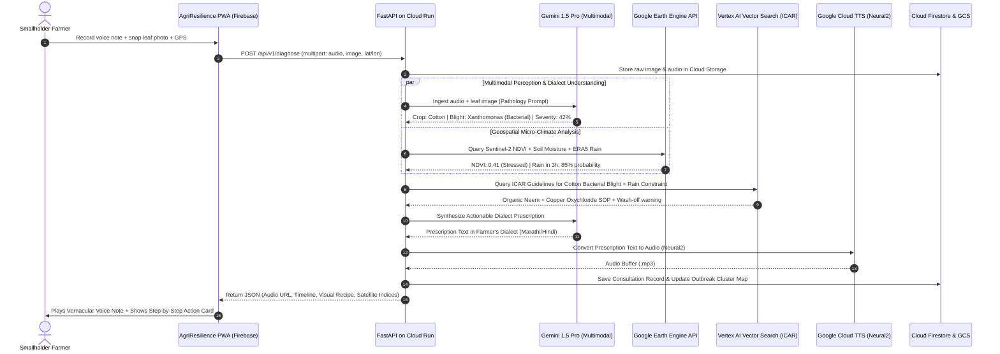

# AgriResilience AI — End-to-End System Architecture
## Production-Grade Multi-Agent Geospatial & Multimodal Engineering Blueprint

> **Compliance**: Formatted specifically for Google Cloud Platform deployment on **Cloud Run** and **Firebase Hosting** in strict accordance with AI Builder Cup 2026 technical requirements.

---

### 1. High-Level Architectural Diagram

```
┌──────────────────────────────────────────────────────────────────────────────────────────────────┐
│                                   CLIENT LAYER (MOBILE WEB PWA)                                   │
│  • Dialect Voice Input (Web Audio API / Opus Audio Stream)                                       │
│  • Macro Leaf Photo Capture (HTML5 Camera API + Client-side Aspect Ratio Validator)              │
│  • Geolocation GPS Coordinates (HTML5 Geolocation API with ±5m Accuracy)                         │
│  • Hosted on: FIREBASE HOSTING (Global CDN, Service Worker Offline Caching)                      │
└──────────────────────────────────────────────┬───────────────────────────────────────────────────┘
                                               │ HTTPS / WSS
                                               ▼
┌──────────────────────────────────────────────────────────────────────────────────────────────────┐
│                             API GATEWAY & ORCHESTRATION (CLOUD RUN)                              │
│  • Framework: Python FastAPI containerized on GOOGLE CLOUD RUN (Region: asia-southeast1)        │
│  • Orchestration: FIREBASE GENKIT / Vertex AI Agent Builder Flows                                │
│  • State Machine: Google Cloud Firestore (Session Memory, Consultation Progress)                 │
└──────┬───────────────────────────────┬──────────────────────────────────┬────────────────────────┘
       │                               │                                  │
       ▼                               ▼                                  ▼
┌───────────────────────────┐ ┌───────────────────────────┐ ┌──────────────────────────────────────┐
│  AGENT 1: MULTIMODAL      │ │  AGENT 2: GEOSPATIAL      │ │  AGENT 3: AGRONOMIC DECISION         │
│  PERCEPTION ENGINE        │ │  EARTH ENGINE AGENT       │ │  & SYNTHESIS AGENT                 │
├───────────────────────────┤ ├───────────────────────────┤ ├──────────────────────────────────────┤
│ • Ingests Leaf Photo &    │ │ • Calls Google Earth      │ │ • Fuses Pathology + Geospatial       │
│   Spoken Voice Note       │ │   Engine Python API       │ │ • Queries Vertex AI Vector Search    │
│ • Model: GEMINI 1.5 PRO   │ │ • Queries Sentinel-2      │ │   (ICAR/FAO Agronomic Guidelines)    │
│ • Detects: Crop type,     │ │   SR for NDVI & NDWI      │ │ • Checks 72h Rain Window             │
│   pathology, lesion       │ │ • Pulls NASA SMAP Volumetric│ • Generates organic non-toxic        │
│   severity (0-100%),      │ │   Soil Moisture           │   remediation recipe & chemical backup │
│   fungal sporulation stage│ │ • Fetches ERA5 Radar      │ │ • Model: GEMINI 1.5 PRO / FLASH      │
└─────────────┬─────────────┘ └─────────────┬─────────────┘ └──────────────────┬───────────────────┘
              │                             │                                  │
              └─────────────────────────────┼──────────────────────────────────┘
                                            │
                                            ▼
┌──────────────────────────────────────────────────────────────────────────────────────────────────┐
│                          AGENT 4: DIALECT AUDIO PRESCRIPTION ENGINE                              │
│  • Synthesizes actionable, culturally tailored remediation narrative                             │
│  • Models: Gemini 1.5 Audio / Google Cloud Neural2 Text-to-Speech (Hindi, Marathi, Bahasa, etc.) │
│  • Output: Compressed streaming audio waveform + structured step-by-step visual prescription card│
└───────────────────────────────────────────┬──────────────────────────────────────────────────────┘
                                            │
                                            ▼
┌──────────────────────────────────────────────────────────────────────────────────────────────────┐
│                             STORAGE & EPIDEMIOLOGICAL RADAR LAYER                                │
│  • Google Cloud Storage: Original Raw Leaf Macros & Synthesized Voice Prescriptions              │
│  • Cloud Firestore: Farmer Profiles, Farm GPS Coordinates, Consultation Records                 │
│  • BigQuery: Anonymous Regional Disease Heatmap (Pest Outbreak Alert within 5km radius)           │
└──────────────────────────────────────────────────────────────────────────────────────────────────┘
```

---

### 2. Detailed Layer-by-Layer Engineering Specifications

#### Layer 1: Client Ingestion (PWA on Firebase Hosting)
- **Deployment**: Firebase Hosting with global edge caching and Service Worker offline caching.
- **Microphone Streaming**: Audio is recorded using `MediaRecorder` API directly in `.webm` / `.opus` format (16kHz sample rate, 16-bit mono PCM equivalent) to minimize bandwidth in 2G/3G rural networks.
- **Macro Image Processing**: High-resolution leaf photo captured via HTML5 Camera input. Client-side Canvas compresses the image to a max dimension of 1920px (JPEG quality 0.85) before upload to save cellular data while preserving fungal spore detail.
- **Geolocation**: Captured via navigator geolocation (`navigator.geolocation.getCurrentPosition`), extracting latitude, longitude, and elevation.

#### Layer 2: API Gateway & Multi-Agent Orchestration (Cloud Run)
- **Runtime**: Python 3.11 with FastAPI running on **Google Cloud Run** (`asia-southeast1` Singapore for sub-80ms JAPAC round-trip latency).
- **Concurrency & Autoscaling**:
  - `min-instances: 1` (to eliminate cold starts during live hackathon demonstrations and judge testing).
  - `max-instances: 10` with CPU throttling disabled during request processing.
  - Memory: 2 GiB per instance, 2 vCPUs.
- **Agent Orchestrator**: Built using **Firebase Genkit** and Python LangGraph to manage stateful transitions between multimodal perception, geospatial fetching, and prescription generation.

#### Layer 3: The Generative AI & Geospatial Core
1. **Multimodal Perception Agent (Gemini 1.5 Pro)**:
   - *Vision Capabilities*: Ingests high-resolution leaf macros. Utilizes few-shot system prompts with botanical lesion taxonomies to detect crop identity (Rice, Cotton, Wheat, Cassava, Tomato), pathogen type (Fungal, Bacterial, Viral, Insect Pests), and lesion area ratio.
   - *Speech Capabilities*: Ingests raw audio of the farmer's spoken query. Understands mixed code-switching (e.g., *Hinglish*, *Tanglish*, *Bahasa Jawa*) without requiring separate speech-to-text translation pipelines.
2. **Geospatial & Micro-Climate Agent (Google Earth Engine API)**:
   - Authenticated via Google Cloud Service Account with Earth Engine permissions.
   - Ingests the farmer’s coordinates $[Lat, Long]$ and executes server-side raster reductions:
     - **Sentinel-2 Surface Reflectance** (`COPERNICUS/S2_SR`): Computes 10m-resolution **NDVI** (Normalized Difference Vegetation Index) to assess photosynthetic vigor across the 1-hectare parcel.
     - **NDWI** (Normalized Difference Water Index): Computes $NIR - SWIR / NIR + SWIR$ to detect canopy moisture stress.
     - **ERA5-Land Precipitation**: Ingests total precipitation forecasts over the next 72 hours.
3. **Agronomic Decision & Synthesis Agent (Gemini 1.5 Pro + Vertex AI Vector Search)**:
   - Grounded via Vertex AI Vector Search against authoritative agricultural extension repositories:
     - Indian Council of Agricultural Research (ICAR) Crop Protection Handbooks.
     - Food and Agriculture Organization (FAO) IPM (Integrated Pest Management) Protocols.
   - **Crucial Rule Engine**: If the 72-hour precipitation probability exceeds 60% within the next 4 hours, the agent automatically flags: `"SPRAYING PROHIBITED: Rain wash-off risk"`.
4. **Dialect Audio Prescription Engine (Cloud TTS Neural2)**:
   - Generates natural, compassionate audio prescriptions using Google Cloud Text-to-Speech Neural2 voices:
     - Hindi: `hi-IN-Neural2-A` / `hi-IN-Neural2-D`
     - Marathi: `mr-IN-Neural2-A`
     - Telugu: `te-IN-Standard-A`
     - Bahasa Indonesia: `id-ID-Neural2-A`
     - Vietnamese: `vi-VN-Neural2-A`

---

### 3. End-to-End Sequence Diagram (Mermaid)



---

### 4. Infrastructure & Production Deployment Architecture

```
┌────────────────────────────────────────────────────────────────────────┐
│               GOOGLE CLOUD ARCHITECTURE IN ASIA-SOUTHEAST1             │
├────────────────────────────────────────────────────────────────────────┤
│ • VPC Network: Custom VPC with VPC Service Controls for data privacy   │
│ • Compute: Google Cloud Run                                            │
│   - Image: gcr.io/agriresilience-2026/backend:latest                   │
│   - CPU: 2.0 vCPU | Memory: 2.0 GiB | Concurrency: 80                  │
│   - Autoscaling: min 1, max 10 instances                               │
│ • Identity & Access: Service Account `agriresilience-sa@...` with      │
│   roles: `roles/aiplatform.user`, `roles/storage.objectAdmin`,         │
│   `roles/datastore.user`, Earth Engine API Developer credentials       │
│ • Frontend Delivery: Firebase Hosting (SSL automated, HTTP/2 push)     │
│ • Operational Telemetry: Cloud Logging & Cloud Monitoring dashboards   │
└────────────────────────────────────────────────────────────────────────┘
```

---
*Next Document*: Comprehensive Feature Specifications and Algorithms in [`03_detailed_feature_specifications.md`](file:///d:/ai_builder/agri_resilience_docs/03_detailed_feature_specifications.md).
